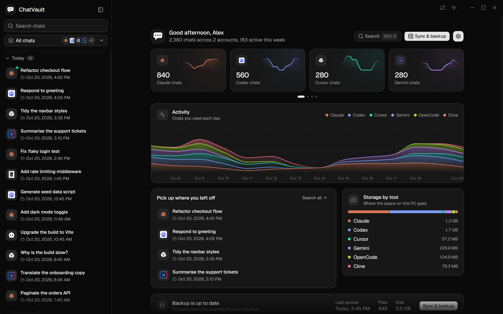
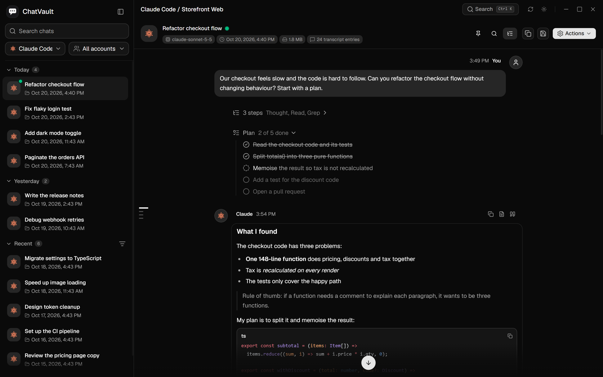
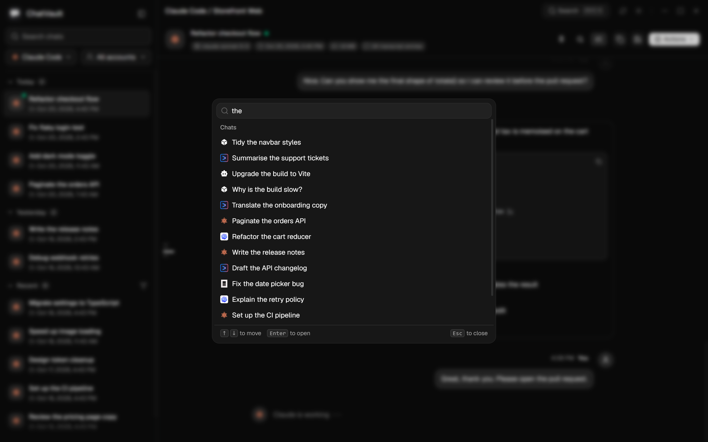
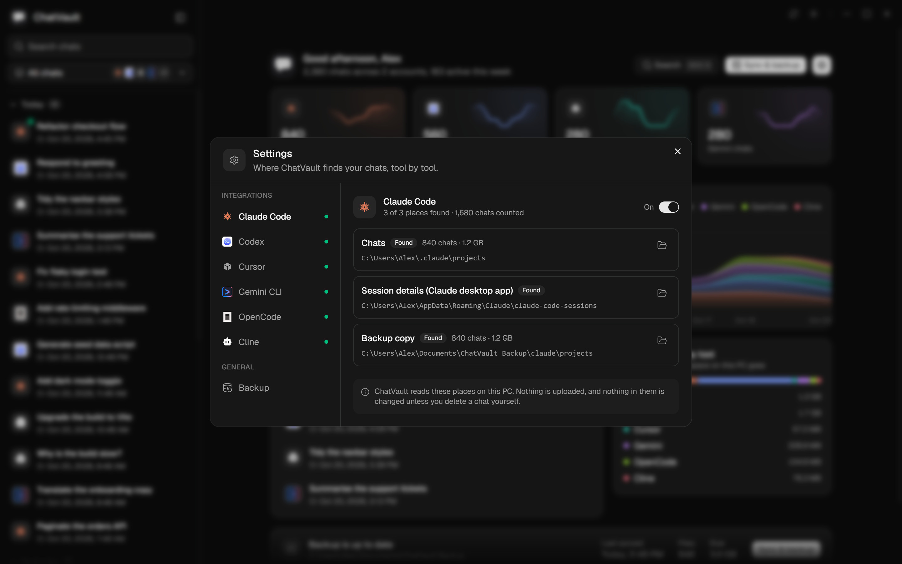
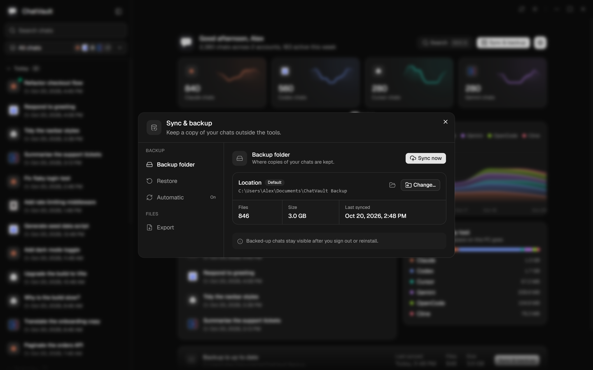

<div align="center">


# ChatVault

**A private, local-first desktop workspace for AI conversation history.**

Browse, search, organize, export, back up, and continue conversations created
by the AI tools already installed on your Linux system.

Claude Code · Codex · Cursor · Grok · Hermes Agent · Gemini CLI · OpenCode · Cline · imported web chats

[](LICENSE)
[](https://tauri.app)
[](#requirements)

</div>

<p align="center">
  
</p>

## What ChatVault does

AI coding tools keep valuable context in separate local folders and formats.
ChatVault brings those conversations together in one native desktop interface
without requiring an account or sending chat content to a remote service.

- **Unified library** — browse conversations from supported coding assistants in
  one place.
- **Fast local search** — search across tools, projects, accounts, and message
  content.
- **Focused reading** — render Markdown, code, images, tool calls, reasoning,
  plans, citations, and other structured content.
- **Organization** — rename, tag, archive, and group conversations by project or
  source.
- **Portable exports** — export conversations as Markdown, HTML, plain text, or
  JSON.
- **CLI handoff** — continue supported conversations in their original command-line
  tool.
- **Backup and sync** — maintain an optional local backup alongside the original
  session files.
- **Web-chat imports** — import NousSave JSON or Markdown exports from services
  such as ChatGPT, Gemini, and Grok.

<details>
<summary><strong>More screenshots</strong></summary>

<p align="center">
  
</p>
<p align="center">
  
</p>
<p align="center">
  
</p>
<p align="center">
  
</p>

</details>

## Supported sources

| Source | Default location |
| --- | --- |
| Claude Code | `~/.claude/projects` |
| Codex | `~/.codex/sessions` |
| Cursor | `~/.cursor` |
| Grok | `~/.grok/sessions` |
| Hermes Agent | `~/.hermes/state.db` (read-only) |
| Gemini CLI | `~/.gemini/tmp` |
| OpenCode | `~/.local/share/opencode/opencode.db` |
| Cline | `~/.cline/data/sessions` |
| NousSave imports | `~/Documents/ChatVault Import` |

The local search index and managed imports are stored in
`~/.local/share/chatvault`. Sources can be enabled individually in Settings.

## Privacy

ChatVault is designed around local data:

- Conversation content is read and indexed on your machine.
- Chat content is not uploaded by ChatVault.
- No ChatVault account is required.
- Imported files remain under ChatVault's local data directory.
- Backups are written only to the folder you select.

Automatic updates are currently disabled. Updates are installed explicitly
from a trusted build or a local checkout.

## Requirements

- Linux with X11 or Wayland
- Node.js 20 or newer
- Rust installed through [rustup](https://rustup.rs/)
- WebKitGTK 4.1 and the native libraries required by Tauri 2

ChatVault is primarily tested on Arch Linux with Omarchy, Hyprland, and
Wayland. The Forgejo build also runs on Ubuntu.

## Build from source

```bash
git clone https://github.com/spalencsar/chatvault.git
cd chatvault
npm ci
source "$HOME/.cargo/env"
npx tauri build --no-bundle --ci
```

The production binary is written to `src-tauri/target/release/chatvault`.
Always use the Tauri CLI for production builds so that the frontend is embedded
in the binary. A plain `cargo build --release` does not perform this step.

For development with hot reload:

```bash
npm ci
npx tauri dev
```

## Install

Prebuilt x86_64 Linux packages are available from the
[latest GitHub release](https://github.com/spalencsar/chatvault/releases/latest):

```bash
# Debian or Ubuntu
sudo apt install ./ChatVault_0.6.1_amd64.deb

# Distribution-independent AppImage
chmod +x ChatVault_0.6.1_amd64.AppImage
./ChatVault_0.6.1_amd64.AppImage
```

When building from source instead, run:

```bash
./scripts/install.sh
```

The installer adds:

- `~/.local/bin/chatvault`
- `~/.local/share/applications/chatvault.desktop`
- `~/.local/share/icons/hicolor/128x128/apps/chatvault.png`

Launch ChatVault from the desktop entry or run `chatvault`. Ensure that
`~/.local/bin` is included in `PATH`.

## Import web conversations

ChatVault supports NousSave exports in JSON (preferred) or Markdown with a YAML
`platform` field. Imports can be started in any of these ways:

1. Copy files into `~/Documents/ChatVault Import`, then scan in ChatVault.
2. Open **Settings → Imported** and choose **Import files** or **Import folder**.
3. Open the command palette with `Ctrl`+`K` and select
   **Import NousSave chats**.

Imported conversations appear under **Imported**, grouped by their original
platform. Duplicate imports are skipped.

## Keyboard shortcuts

| Shortcut | Action |
| --- | --- |
| `Ctrl`+`K` | Open the command palette and global search |
| `Ctrl`+`F` | Find text in the current conversation |
| `Esc` | Close the active search interface |

## Development and releases

Development happens in Forgejo; GitHub is the public mirror. Forgejo Actions
tests and builds code changes before mirroring `main`. Documentation-only
changes skip the native build but are still mirrored.

See [CONTRIBUTING.md](CONTRIBUTING.md) for development notes and
[CHANGELOG.md](CHANGELOG.md) for release history.

## Project lineage

This codebase originated from
[Sanaullah Rais's Chat-Vault](https://github.com/ssanaullahrais/Chat-Vault) and
continues as a Linux-focused fork with additional integrations, local import
workflows, XDG/Wayland support, and Linux-native packaging. It is maintained as
an independent continuation with its own direction and release process.

The original MIT license and copyright notice are retained. See
[NOTICE](NOTICE) for attribution.

## License

[MIT](LICENSE) © Sanaullah Rais and contributors. Additional Linux integration
and adaptation work © Sebastian Palencsar.

ChatVault is an independent project and is not affiliated with Anthropic,
OpenAI, Google, xAI, Anysphere, or the providers of supported tools.
